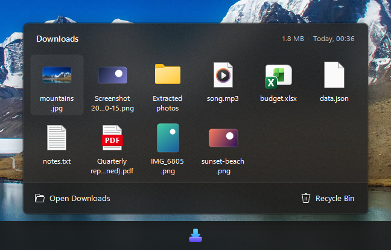
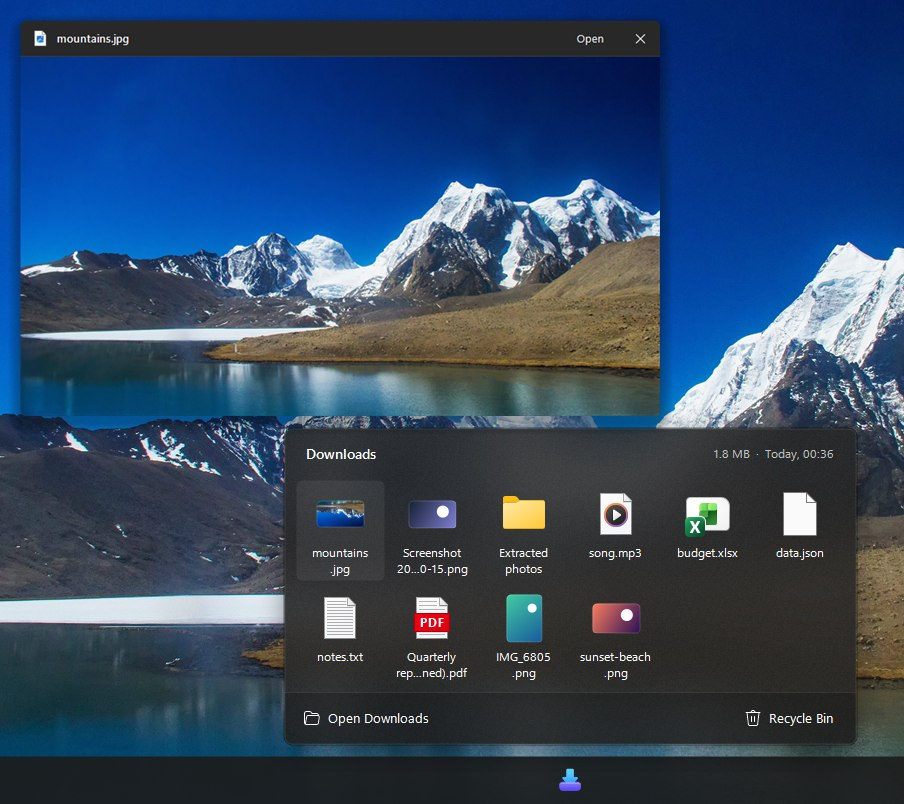
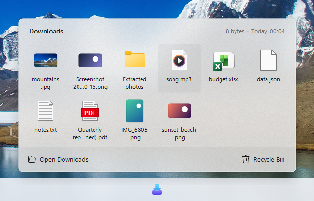
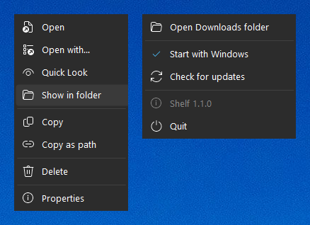

<p align="center">
  
</p>

<h1 align="center">Shelf</h1>

<p align="center">
  <strong>A macOS-style Downloads stack for the Windows 11 taskbar.</strong><br>
  Click the folder, see what just landed, drag it wherever it belongs.
</p>

<p align="center">
  
</p>

<p align="center">
  
  
  
  
</p>

---

Windows 11 has no way to get at your downloads from the taskbar. The feature that
came closest, taskbar toolbars, which could pin a folder you could expand and
drag out of, was removed in Windows 11 and there is no setting that brings it
back.

Shelf puts it back. It sits in the taskbar as one more icon, at the end of your
app cluster. Click it and a frosted panel rises above the bar with whatever is
in your Downloads folder, newest first.

## What it does

- **Quick Look.** Press <kbd>Space</kbd> to preview the selected file, the way
  macOS does: photos, PDFs, Office documents, text and code, video. It works in
  the panel and also in Explorer and on the desktop, and the arrow keys flip
  through files with the preview following.
- **Drag files out.** Onto the desktop, into Explorer, into a chat window,
  anywhere that accepts a file. The file's own icon follows the cursor.
- **Select like Explorer.** Drag a box over empty space, or Ctrl- and
  Shift-click, then drag, copy or delete the lot at once.
- **Drag files in.** Drop anything on the panel, or straight on the taskbar
  icon, and it moves into Downloads. Ctrl to copy.
- **Drop on the bin** to recycle, undoably, because it goes through the shell
  rather than deleting outright.
- **Folders too**, not just files, with their real Explorer icons and photo
  previews.
- **Live.** A watcher updates the grid the moment something downloads, even
  with the panel open; the icon bounces and shows a dot until you look.
- **Newest first, honestly.** Sorted by when a file arrived, so an extracted
  archive or a photo carrying an old date still lands at the top.
- **Keyboard too.** Arrows, Enter, Delete, Ctrl+A, Ctrl+C, Shift to extend.
- **Every screen.** With a taskbar on each monitor, each gets its own icon,
  and the panel opens on the screen you clicked.
- **Follows Windows.** Light or dark, your accent colour, and per-monitor
  scaling.
- **Gets out of the way** when something goes fullscreen on the taskbar's
  screen, and when an auto-hiding taskbar tucks itself away.

## A closer look

<p align="center">
  
</p>
<p align="center"><sub><b>Quick Look.</b> <kbd>Space</kbd> on a file zooms its preview out of the icon, right beside it, in the panel, in Explorer or on the desktop.</sub></p>

<table align="center">
  <tr>
    <td></td>
    <td></td>
  </tr>
  <tr>
    <td align="center"><sub><b>Dark</b></sub></td>
    <td align="center"><sub><b>Light</b>, following Windows</sub></td>
  </tr>
</table>

<p align="center">
  
</p>
<p align="center"><sub>Right-click a tile, or the taskbar icon.</sub></p>

## Install

Download `shelf.exe` from the [Releases](../../releases) page and run it, or build
it yourself:

```powershell
git clone https://github.com/rui-branco/shelf.git
cd shelf
.\install.ps1
```

`install.ps1` builds, puts the executable in `%LOCALAPPDATA%\Shelf`, adds a Start
Menu shortcut and starts it. Install it somewhere permanent like that rather than
running it out of `bin`: both **Start with Windows** and the updater work against
the running executable's own path, so a build output that later moves breaks them.

Right-click the icon for **Start with Windows** to have it there on every login.

## Using it

| Action | Result |
| --- | --- |
| Click the taskbar icon | Open and close the stack |
| Click a tile | Select it, as in Explorer (Quick Look follows if it is open) |
| Double-click a tile | Open that file or folder |
| <kbd>Ctrl</kbd>+click, <kbd>Shift</kbd>+click | Add one tile, or a range, to the selection |
| Drag across empty space | Select every tile the box touches (<kbd>Ctrl</kbd> to add) |
| Drag a tile out | Move or copy it, or the whole selection, anywhere |
| Drag a file onto the panel or the taskbar icon | Move it into Downloads (<kbd>Ctrl</kbd> to copy) |
| Drop tiles on **Recycle Bin** | Send them to the bin |
| <kbd>Space</kbd> | Quick Look the selection, in the panel, Explorer or on the desktop |
| Right-click a tile | Open, Open with, Quick Look, Show in folder, Copy, Copy as path, Delete, Properties |
| Right-click the taskbar icon | Open Downloads, Start with Windows, Check for updates, Quit |
| Arrow keys, <kbd>Home</kbd>, <kbd>End</kbd> | Move the selection (<kbd>Shift</kbd> to extend) |
| <kbd>Ctrl</kbd>+<kbd>A</kbd> | Select everything |
| <kbd>Enter</kbd> / <kbd>Delete</kbd> / <kbd>Ctrl</kbd>+<kbd>C</kbd> | Open, recycle or copy the selection |
| <kbd>Alt</kbd>+<kbd>Enter</kbd> | Properties, one combined sheet for several files |
| Mouse wheel | Scroll, when there are more files than fit |
| <kbd>Esc</kbd> | Close Quick Look, then the stack, or cancel a drag |

Settings live in `%APPDATA%\Shelf\config.json`: which folder to watch and how
many items to keep (the grid scrolls through them).

## Updates

Right-click the icon and choose **Check for updates**. Shelf also looks once at
startup, quietly: if a newer release is out, that item reads **Update to Shelf
1.2.0** the next time you open the menu, and the version it is running is written
at the foot of the menu either way.

Updating downloads that release's `shelf.exe`, moves the running build aside,
swaps the new one in and restarts. Windows will not let a running executable be
overwritten, but it will let it be renamed, and the build that stepped aside is
swept up on the next start.

The repository is pinned in the source rather than read from config: an updater
that can be pointed elsewhere by a settings file is a way to make Shelf run
someone else's code. A release is only offered if it is not a draft or a
prerelease and has a `shelf.exe` attached, and the download is rejected unless it
really is a program.

## Known limits

- **It cannot reserve space on the taskbar.** Only a shell extension can do
  that, and Windows 11 dropped the interface. Shelf is a floating window that
  keeps itself positioned after your last app icon, so it moves as the cluster
  re-centres.
- **It hides while the Start menu is open.** Parenting into the taskbar would
  fix that, and does, but the taskbar's XAML layer then owns hit testing and the
  icon becomes visible and unclickable. Being clickable matters more.
- **The panel's blur is a snapshot** taken as it opens, so it does not track
  content moving behind it. For a panel that lives a few seconds, that is not
  worth a live capture.
- **Quick Look takes Space from Explorer's file list.** Only there, and only
  with no modifier held: renaming, the address bar and search keep Space.
  Explorer's own use of plain Space in the list (selecting the focused item) is
  the price.

## Licence

MIT. See [LICENSE](LICENSE).
